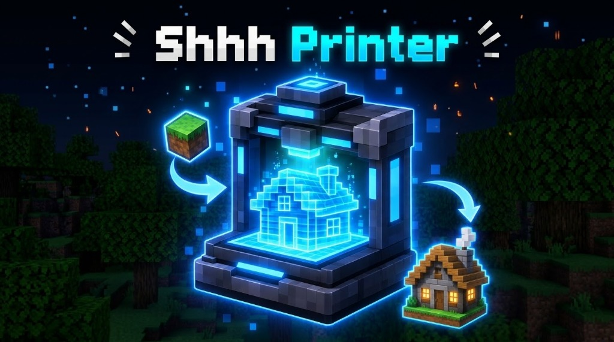
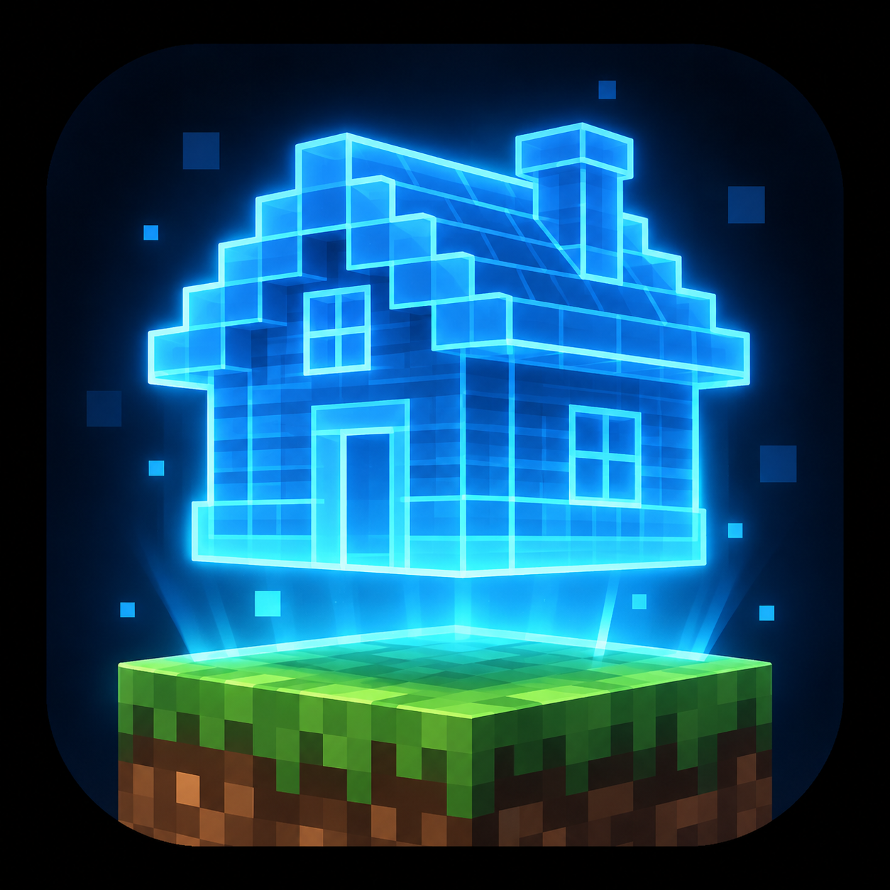
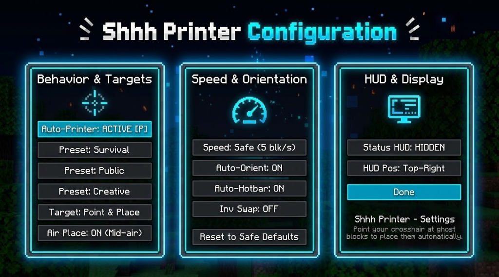

# Shhh Printer

 

**An automated schematic block-placement companion mod for [Shhh Builder](https://github.com/rafayshhh/shhh-builder).**  
*Aim-assisted Point & Place crosshair targeting • Built-in speed presets • Fair-play defaults • Zero aura cheating*

---

## Overview

**Shhh Printer** is a client-side automated building companion designed specifically for **[Shhh Builder](https://github.com/rafayshhh/shhh-builder)** on Minecraft 26.3 (Fabric).

Unlike conventional schematic printers that deploy full 360-degree aura placement around the player, Shhh Printer defaults to an intuitive **Point & Place** targeting system: it places only the specific ghost block your crosshair is aimed at. Point your crosshair at an unplaced schematic block within reach, and Shhh Printer handles the placement, orientation, and hotbar selection with legitimate human-like timing. Look away, and placement immediately stops.

---

## Key Features

### Point & Place Targeting
- **Crosshair-Driven Building**: The printer evaluates the ghost block directly targeted by your crosshair. It places blocks only when you look at them, keeping you in full control of where and when construction proceeds.
- **Fair-Play Defaults**: Air placement is disabled by default. Blocks require valid adjacent supporting surfaces, strictly adhering to vanilla placement mechanics.
- **Optional Area Mode**: For singleplayer testing and creative world building, full 360-degree Area mode can be toggled on demand (`/shhhprinter target all`).

### Built-in Configuration Presets
Quickly switch between pre-configured operational profiles via chat (`/shhhprinter preset <survival|public|creative>`) or the graphical settings menu:
- **Survival (Default)**: 1 block/tick with a 2-tick delay (~10 blocks/sec legit cadence). Air placement disabled, strict adjacent support required, automatic hotbar selection enabled.
- **Public Server (Safe)**: 1 block/tick with a 4-tick delay (~5 blocks/sec anti-cheat safe cadence). Air placement disabled, strict adjacent support required, inventory swapping disabled to eliminate rapid inventory packet spikes.
- **Creative (Fast)**: 3 blocks/tick with 0-tick delay. Air placement enabled, strict adjacent support disabled for rapid structure generation.

### Graphical Configuration Screen (`O`)

Configure all printer settings through an in-game graphical user interface featuring a grouped layout:

- **Behavior & Targets**: Toggle auto-printer, cycle presets, set target mode (Point & Place vs Area), and toggle air placement.
- **Speed & Orientation**: Adjust placement rate, toggle directional block auto-orientation, hotbar auto-switching, and main inventory swapping.
- **HUD & Display**: Toggle status overlay HUD and reposition it across screen corners to prevent UI overlaps.

### Smart Inventory & Placement Automation
- **Hotbar Auto-Switching**: Automatically detects the required block and equips it from your hotbar with proper client-to-server sync packets (`ServerboundSetCarriedItemPacket`).
- **Main Inventory Swapping**: Intelligently swaps fresh block stacks from your main inventory into your hotbar when an active stack is depleted.
- **Directional Orientation**: Automatically calculates hit vectors and pitch angles for slabs, stairs, logs, and directional blocks to ensure correct placement.
- **Player State Safety**: Automatically halts placement when you are dead, in spectator mode, sleeping, or actively mining blocks.
- **Collision Protection**: Strictly refuses to place blocks inside player bounding boxes, preventing suffocation and glitching.

---

## Controls

Configure keybindings in **Options -> Controls -> Key Binds -> Shhh Printer**:

| Action | Default Key | Category | What it does |
| :--- | :---: | :--- | :--- |
| **Toggle Auto-Printer** | **P** | Shhh Printer | Turn automated block placement on or off |
| **Open Configuration** | **O** | Shhh Printer | Open the graphical configuration screen |

---

## Chat Commands (`/shhhprinter`)

All functionality can also be managed directly via client-side chat commands:

| Command | Description |
| :--- | :--- |
| `/shhhprinter toggle` | Toggle automated block placement on or off |
| `/shhhprinter on` | Explicitly activate the printer |
| `/shhhprinter off` | Explicitly deactivate the printer |
| `/shhhprinter target <crosshair\|all>` | Switch between Point & Place (crosshair) and Area 360 mode |
| `/shhhprinter preset <survival\|public\|creative>` | Apply an operational speed and safety preset |
| `/shhhprinter speed <1-5>` | Set maximum blocks placed per placement tick |
| `/shhhprinter delay <0-10>` | Set delay in ticks between placement actions |
| `/shhhprinter mode <strict\|air>` | Toggle strict adjacent support requirement vs air placement |
| `/shhhprinter config` | Open the graphical configuration screen |
| `/shhhprinter stats` | View current status, target mode, speed, and placement statistics |

---

## Installation & Requirements

1. Install **Fabric Loader** (`0.20.1` or newer) for **Minecraft 26.3**.
2. Install **Fabric API** for Minecraft 26.3.
3. Install **[Shhh Builder](https://github.com/rafayshhh/shhh-builder)** (`1.0.0` or newer). *Shhh Printer requires Shhh Builder to read schematic placements and render ghost blocks.*
4. Download **`shhh-printer-1.0.0.jar`** and place it in your `.minecraft/mods` directory.
5. Launch Minecraft.

---

## Server Compliance & Fair Play

Shhh Printer runs entirely on the client side. In its default **Survival** and **Public Server** presets:
- Blocks are placed one at a time using legitimate client interaction rays.
- Placements require a physical supporting block adjacent to the target position.
- Blocks are placed exclusively where the player is looking, respecting reach distance and line of sight.
- No server-side mod installation or custom server packets are required.

Always verify the rules of your multiplayer server before enabling automated placement tools.

---

## Documentation

Full architectural documentation, audit reports, and developer guides are available in the [Documentation](Documentation/) directory:
- [System Architecture](Documentation/ARCHITECTURE.md)
- [Audit Report](Documentation/AUDIT.md)
- [Testing Guide](Documentation/TESTING.md)
- [Changelog](Documentation/CHANGELOG.md)
- [UI Style Guide](Documentation/UI_STYLE.md)
- [Modrinth Metadata](Documentation/MODRINTH_METADATA.md)
- [CurseForge Metadata](Documentation/CURSEFORGE_METADATA.md)
- [Socials & Branding](Documentation/SOCIALS_AND_BRANDING.md)

---

## License & Source

Licensed under the [MIT License](LICENSE).  
Source code, releases, and issue tracking are hosted on [GitHub](https://github.com/rafayshhh/shhh-printer).
